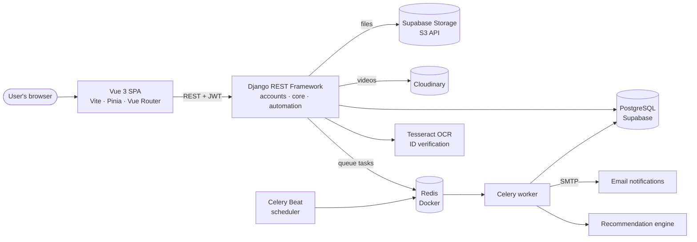

<h1 align="center">🎓 BrightPath LMS</h1>

<p align="center">
  A learning management system built for Sri Lankan universities: verified student and lecturer accounts,
  a shared digital library, peer-tutoring ("Kuppi") sessions, a gamified points wallet and activity-based study recommendations.
</p>

<p align="center">
  
  
  
  
  
  
</p>

<p align="center">
  <a href="#-run-it-locally">Run locally</a> ·
  <a href="#%EF%B8%8F-architecture">Architecture</a> ·
  <a href="#-my-role">My role</a>
  <!-- Add when ready: · <a href="https://YOUR-DEMO-URL">Live demo</a> · <a href="https://YOUR-VIDEO-URL">Video walkthrough</a> -->
</p>

<!-- TODO: add screenshots to docs/screenshots/ (landing, dashboard, library, Kuppi, wallet), then uncomment:

-->

---

## ✨ What it does

| Feature | Details |
|---|---|
| 🪪 **Identity verification** | Students, lecturers and staff register with their own dashboards. Uploaded ID cards and credential documents are read with Tesseract OCR to verify the account. |
| 📚 **Digital library** | Upload and browse study materials (PDF, DOCX, video), filtered by file type. Files are stored on Supabase Storage (S3-compatible); videos on Cloudinary. |
| 👥 **Kuppi sessions** | Schedule, discover and join peer-led tutoring sessions, including live and video sessions. |
| 🪙 **Points wallet** | Students earn points for uploading and engaging with content, encouraging knowledge sharing. |
| 🔔 **Automated notifications** | HTML emails and in-app alerts when new resources are uploaded, plus automatic post-download feedback requests, all sent in the background. |
| 🎯 **Recommendations** | A recommendation engine analyses viewed and completed modules across students to suggest relevant materials, recalculated as a background job. |

---

## 🏗️ Architecture



**Why it's built this way**

- **Decoupled SPA + REST API:** the Vue frontend talks to Django only through JSON endpoints with stateless JWT auth (SimpleJWT), so either side can be deployed or scaled on its own.
- **Background work goes to a queue:** sending emails, feedback requests and recalculating recommendations run in Celery workers via Redis, so API requests stay fast.
- **Scheduled jobs with Celery Beat** trigger periodic tasks such as feedback reminders and recommendation updates.

---

## 🧰 Tech stack

| Layer | Tools |
|---|---|
| Frontend | Vue 3, Vite, Pinia, Vue Router, Axios, Tailwind CSS |
| Backend | Python, Django 6, Django REST Framework, SimpleJWT |
| Database & storage | PostgreSQL (Supabase), Supabase Storage via `django-storages` + `boto3`, Cloudinary |
| Async & DevOps | Celery, Celery Beat, Redis in Docker (Docker Compose) |
| Document processing | PyTesseract (OCR), PyPDF2, python-docx, ReportLab |

---

## 🚀 Run it locally

**Prerequisites:** Python 3.12+, Node.js 20.19+ (or 22.12+), Docker, and [Tesseract OCR](https://github.com/tesseract-ocr/tesseract) installed.

```bash
git clone https://github.com/Gagana0819/BrightPath-LMS-ITPM-.git
cd BrightPath-LMS-ITPM-
```

**1. Start Redis (message broker)**

```bash
cd backend
docker compose up -d
```

**2. Backend API** (in `backend/`)

```bash
python -m venv venv
source venv/bin/activate        # Windows: venv\Scripts\activate
pip install -r requirements.txt
cp .env.example .env            # then fill in your own values
python manage.py migrate
python manage.py createsuperuser
python manage.py runserver      # http://127.0.0.1:8000
```

**3. Background workers** (two more terminals in `backend/`)

```bash
celery -A brightpath worker --loglevel=info -P eventlet   # -P eventlet is needed on Windows
celery -A brightpath beat --loglevel=info
```

**4. Frontend** (in `frontend/`)

```bash
npm install
npm run dev                     # http://localhost:5173
```

### Environment variables

See [`backend/.env.example`](backend/.env.example). Never commit your real `.env`.

| Variable | Purpose |
|---|---|
| `DJANGO_SECRET_KEY` | Django secret key |
| `SUPABASE_DB_URL` | PostgreSQL connection string |
| `SUPABASE_S3_ACCESS_KEY`, `SUPABASE_S3_SECRET_KEY`, `SUPABASE_S3_BUCKET`, `SUPABASE_S3_ENDPOINT` | File storage |
| `CLOUDINARY_CLOUD_NAME`, `CLOUDINARY_API_KEY`, `CLOUDINARY_API_SECRET` | Video storage |
| `CELERY_BROKER_URL`, `CELERY_RESULT_BACKEND` | Redis URLs (default `redis://localhost:6379/0`) |
| `EMAIL_HOST_USER`, `EMAIL_HOST_PASSWORD` | SMTP account for notifications (use a Gmail app password) |

---

## 👨‍💻 My role

Team project for IT Project Management (4 members). I was the **largest contributor (37 of 74 commits)**, working across the stack:

- Built most of the **Vue frontend**: landing page with animations, dashboards, digital library, Kuppi session views, profile and wallet pages, routing with auth guards and Pinia stores.
- Built **backend features** in Django REST: the identity-verification registration flow, digital library with real data, the points wallet, and the core models, serializers and endpoints.
- Set up the **async system**: Celery + Redis (Dockerized), the automated email notification system, and the automated feedback & review system.
- Built the **recommendation engine** and its background update task.

---

## 💡 What I learned & what I'd improve

**Learned**
- Moving slow work (emails, recommendations) out of the request cycle with Celery made the API noticeably more responsive, and taught me how queues, workers and schedulers fit together.
- OCR on real ID card photos is messy: lighting and image quality matter as much as the code.
- Working in a 4-person repo taught me how painful merge conflicts get without feature branches, which is why I now use branches and pull requests.

**Next improvements**
- [ ] Containerise the whole stack (API, worker, beat, frontend, Postgres, Redis) so it runs with a single `docker compose up`
- [ ] GitHub Actions pipeline: lint, run tests, build images
- [ ] Move remaining hard-coded settings (secret key, API URL) to environment variables
- [ ] Replace ad-hoc test scripts with a proper `pytest` suite
- [ ] Deploy a public demo
